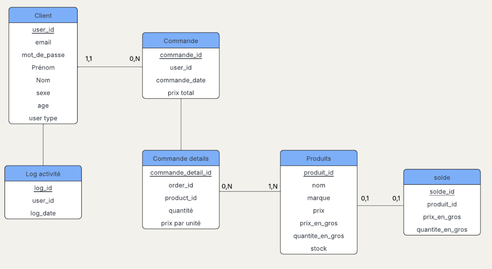

# Shopping App – Application de panier d'achat en Java

Application de shopping en **Java** avec interface graphique et base de données **MySQL**.
Projet d'équipe réalisé en 3e année du cycle ingénieur (ING3) à l'**ECE Paris**, 2025.

## Le projet

L'application permet à un client de parcourir un catalogue d'articles de différentes marques, de remplir un panier et d'obtenir sa facture, avec des remises sur les achats en grande quantité.
Un espace administrateur permet de gérer le stock, les remises, les clients et de consulter des statistiques de ventes.

## Fonctionnalités

**Côté client**
- Inscription et connexion (identifiant et mot de passe)
- Recherche d'articles par nom et par marque
- Panier et calcul de la facture, avec **prix de gros** (ex. 12 articles à 0,50 € ou 4 € les 10 → 5 €)
- Écran de paiement (simulé)
- Historique des commandes

**Côté administrateur**
- Gestion du stock d'articles (ajout, modification, suppression)
- Gestion des remises et des clients
- **Statistiques de ventes** sous forme de graphiques (JFreeChart)

## Architecture

- **MVC** : séparation entre l'interface (Vue), la logique (Contrôleur) et les données (Modèle)
- **DAO + JDBC** : accès à la base de données MySQL
- Interface graphique en **Java Swing**

  

## Lancer le projet

1. Créer la base de données MySQL avec le script shopping.sql
2. Renseigner les identifiants MySQL dans LoginController.java
3. Lancer la classe Main depuis IntelliJ ou Eclipse

## Équipe

Projet réalisé en équipe de 4 étudiants.
